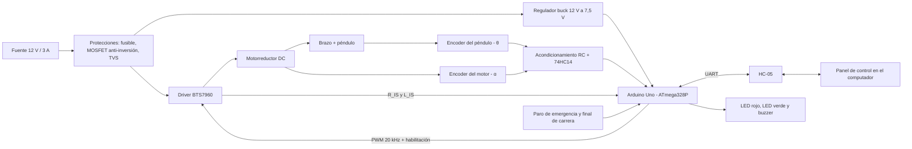
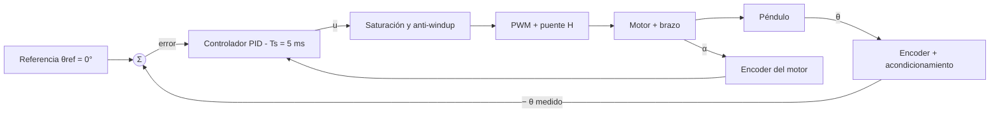
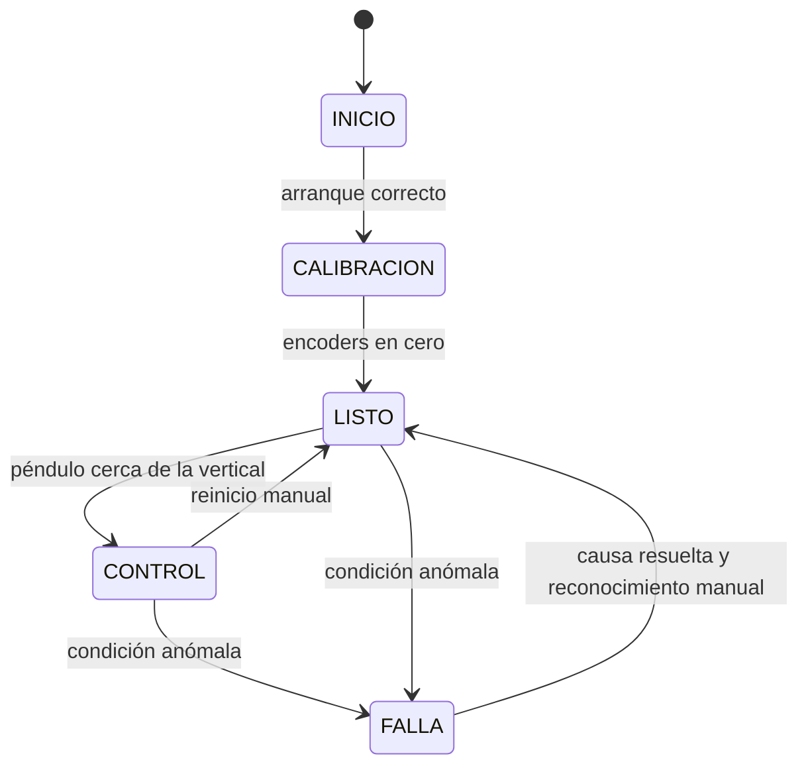

# RotPen: sistema embebido de control para un péndulo invertido rotatorio tipo Furuta basado en Arduino

**Proyecto de aula – Sistemas Embebidos – Corte 2, Avance 2**

| Campo | Información |
| --- | --- |
| Proyecto | RotPen – Rotary Inverted Pendulum |
| Asignatura | Sistemas Embebidos |
| Integrantes | [COMPLETAR: nombres completos] |
| Docente | [COMPLETAR] |
| Repositorio | [COMPLETAR: URL de GitHub o GitLab] |
| Fecha de entrega | [COMPLETAR] |

> Nota para el grupo: todo texto marcado como `[COMPLETAR]` debe ser reemplazado con información real del grupo antes de la entrega. Las figuras 4 a 10 deben ser diseñadas y fotografiadas por el grupo (ver sección 5.9).

---

## Contenido

1. [Título, objetivo general y objetivos específicos](#1-título-objetivo-general-y-objetivos-específicos)
2. [Planteamiento del problema](#2-planteamiento-del-problema)
3. [Estado del arte y marco teórico](#3-estado-del-arte-y-marco-teórico)
4. [Introducción y listado de materiales](#4-introducción-y-listado-de-materiales)
5. [Componente técnico](#5-componente-técnico)
6. [Verificación de la metodología, del cronograma y dificultades](#6-verificación-de-la-metodología-del-cronograma-y-dificultades)
7. [Referencias](#7-referencias)
8. [Anexo A. Lista de verificación frente a la rúbrica](#8-anexo-a-lista-de-verificación-frente-a-la-rúbrica)

---

## 1. Título, objetivo general y objetivos específicos

### 1.1 Título del proyecto

**RotPen: diseño e implementación de un sistema embebido de control PID con tarjeta de circuito impreso propia para estabilizar un péndulo invertido rotatorio basado en Arduino.**

### 1.2 Objetivo general

Diseñar e implementar un prototipo embebido, basado en Arduino, capaz de estabilizar un péndulo invertido rotatorio en su posición vertical superior mediante un controlador PID, integrando acondicionamiento de señales, etapa de potencia, transmisión de variables en tiempo real, supervisión de seguridad y una tarjeta de circuito impreso (PCB) propia.

### 1.3 Objetivos específicos

1. **Objetivo específico 1 (análisis y selección):** definir los requisitos funcionales y no funcionales del sistema y seleccionar, mediante una evaluación comparativa, la arquitectura electromecánica más adecuada entre tres propuestas.
2. **Objetivo específico 2 (diseño electrónico y PCB):** diseñar y fabricar la etapa de acondicionamiento de señales, la etapa de potencia, las protecciones y la PCB que integre el microcontrolador, de modo que el prototipo quede ensamblado y listo para su programación final.
3. **Objetivo específico 3 (control, comunicación y validación):** implementar y sintonizar el controlador PID con un periodo de muestreo fijo, desarrollar la transmisión de variables hacia un panel de control y validar el desempeño frente a los requisitos no funcionales (error en estado estacionario de ±2° y respuesta ante perturbaciones).

*Tabla 1. Correspondencia entre los objetivos de este avance y los siete objetivos del Avance 1.*

| Objetivo de este documento | Objetivos equivalentes del Avance 1 |
| --- | --- |
| Objetivo específico 1 | Objetivos 1 y 2 |
| Objetivo específico 2 | Objetivos 4 y 6 |
| Objetivo específico 3 | Objetivos 3, 5 y 7 |

---

## 2. Planteamiento del problema

El péndulo invertido rotatorio es un sistema subactuado, no lineal y de equilibrio inestable, muy utilizado como banco de pruebas académico para el diseño de controladores. Un motor gira un brazo horizontal alrededor de un eje vertical; en el extremo del brazo se articula un péndulo que gira libremente en un plano perpendicular al brazo. El único actuador debe controlar de forma indirecta y acoplada dos grados de libertad: la posición angular del brazo (α) y el ángulo del péndulo respecto a la vertical (θ).

El desafío técnico central consiste en mantener el péndulo balanceado en su punto de equilibrio inestable (vertical hacia arriba), reaccionando ante perturbaciones y ante la dinámica de arrastre generada por el movimiento del brazo, con un microcontrolador de recursos acotados (Arduino Uno, arquitectura de 8 bits a 16 MHz, 2 KB de SRAM) que debe sostener un lazo de control en tiempo real. A esto se suman restricciones propias de un proyecto de aula:

- La transmisión de variables al panel de control y la supervisión de seguridad no deben introducir retardos que comprometan la estabilidad del lazo.
- La fricción, las holguras mecánicas (poleas y correas) y la resolución finita de los encoders introducen no linealidades y ruido.
- El torque disponible del motor es limitado, lo que acota la capacidad de recuperación ante perturbaciones grandes.
- El sistema debe integrarse en una PCB propia con protecciones eléctricas, dentro de un presupuesto y un tiempo (un semestre) acotados.

**Pregunta orientadora:** ¿cómo diseñar un sistema embebido basado en Arduino, con acondicionamiento de señales, etapa de potencia, supervisión de seguridad y PCB propia, que permita estabilizar un péndulo invertido rotatorio con un controlador PID y transmitir sus variables en tiempo real?

Esta redacción es consistente con el análisis del problema y la definición de requisitos del Avance 1 (variables críticas θ, α, ω, u(t), par motor, fricción, resolución del encoder y periodo de muestreo).

---

## 3. Estado del arte y marco teórico

### 3.1 Estado del arte

El péndulo de Furuta fue propuesto en el Instituto de Tecnología de Tokio y se convirtió en un banco de pruebas clásico de la teoría de control. Los trabajos de Furuta, Yamakita y Kobayashi [1] y de Åström y Furuta [2] establecieron las bases del levantamiento (*swing-up*) del péndulo mediante control por energía, estrategia que luego se combina con un controlador de estabilización cerca de la vertical.

En el ámbito académico hispano y latinoamericano abundan implementaciones de bajo costo con Arduino. La Tabla 2 resume trabajos relevantes y su relación con RotPen.

*Tabla 2. Trabajos relacionados con el péndulo invertido rotatorio sobre Arduino.*

| Referencia | Enfoque | Plataforma y sensores | Relación con RotPen |
| --- | --- | --- | --- |
| Montosa Chena (Univ. de Granada) [3] | Modelado lagrangiano y control LQR del péndulo de Furuta, probado en C++ y en Simulink | Arduino, potenciómetro, motor DC y encoder | Referencia para el modelo dinámico y para la caracterización del motor |
| Diseño, implementación y control de un péndulo invertido rotacional (UPV) [4] | Diseño propio de bajo costo y pequeño tamaño, con una segunda versión para facilitar la estabilización | Arduino | Referencia para la construcción económica y para la iteración de diseño |
| Arévalo Parra et al. (ITESI, 2017) [5] | Control PID para la posición del péndulo y *swing-up* | Arduino Uno | Es la referencia más cercana al enfoque PID sobre Arduino Uno elegido en RotPen |
| Martínez Villamizar (UIS, 2012) [6] | Diseño y construcción de un péndulo rotativo para un laboratorio de sistemas dinámicos | Arduino Mega 2560 | Referencia nacional de construcción mecánica y de acople del encoder al péndulo |
| Donatoni et al. (2024) [7] | Investigación numérica y experimental del *swing-up* con Arduino, incluyendo LQR | Arduino para adquisición de variables de estado y comandos de control | Referencia reciente sobre las limitaciones de adquisición y control en Arduino |
| Reis y Bracco (USP, 2021) [8] | Plataforma didáctica de métodos de control con interfaz computador–Arduino | Arduino | Referencia para el panel de control y la interfaz de visualización |

**Brecha identificada.** La mayoría de los trabajos documentan el modelo, el algoritmo de control y la prueba en banco, pero dedican poca atención al diseño de una PCB propia con protecciones, separación de tierras y supervisión embebida independiente del enlace de comunicación. RotPen busca cubrir esa brecha, manteniendo el costo bajo y una arquitectura modular. Existen además plataformas comerciales de laboratorio (por ejemplo, la familia Quanser), que son robustas pero, en general, de costo elevado para un laboratorio de aula.

### 3.2 Marco teórico

#### 3.2.1 Péndulo invertido rotatorio

El sistema posee dos coordenadas generalizadas: el ángulo del brazo α y el ángulo del péndulo θ, medido desde la vertical superior (θ = 0°). Su dinámica se obtiene con la mecánica de Lagrange y tiene la forma matricial

$$
M(q)\,\ddot{q} + C(q,\dot{q})\,\dot{q} + G(q) = \tau, \qquad q = \begin{bmatrix}\alpha \\ \theta\end{bmatrix}
$$

donde M(q) es la matriz de inercia, C(q, q̇) agrupa los términos de Coriolis y centrífugos, G(q) contiene los efectos gravitatorios y τ es el torque aplicado solo sobre el brazo (por eso el sistema es subactuado: hay dos coordenadas y un único actuador).

Alrededor del punto de equilibrio inestable (θ ≈ 0, θ̇ ≈ 0) el modelo puede linealizarse y escribirse en variables de estado $x = [\alpha,\ \theta,\ \dot{\alpha},\ \dot{\theta}]^T$:

$$
\dot{x} = A\,x + B\,u, \qquad y = C\,x
$$

El modelo linealizado tiene un polo real positivo, lo que confirma la inestabilidad en lazo abierto. Los parámetros numéricos (masas, longitudes, inercias, fricciones) se identificarán sobre el prototipo construido.

#### 3.2.2 Estrategias de control

- **Estabilización cerca de la vertical:** controladores lineales (PID, realimentación de estados, LQR) válidos en un entorno pequeño de θ = 0.
- **Levantamiento (*swing-up*):** control no lineal por energía que lleva el péndulo desde la posición colgante hasta la vecindad de la vertical. Con θ = 0 en la posición superior, la energía del péndulo es

$$
E = \tfrac{1}{2} J_p \dot{\theta}^2 + m_p g\, l_p\,(\cos\theta - 1)
$$

que vale 0 en el equilibrio superior y −2 m_p g l_p en la posición colgante en reposo.

- **Alcance de RotPen en esta etapa:** estabilización con PID sobre θ, complementada con un término sobre α (derivativo o proporcional) para evitar que el brazo se desplace indefinidamente. El *swing-up* se plantea como trabajo futuro; en las pruebas el péndulo se llevará a la vertical manualmente.

#### 3.2.3 Controlador PID discreto

Con periodo de muestreo T_s, la ley de control discreta con error e[k] = θ_ref − θ[k] es

$$
u[k] = K_p\,e[k] + K_i\,T_s \sum_{j=0}^{k} e[j] + K_d\,\frac{e[k]-e[k-1]}{T_s}
$$

Para su implementación sobre un microcontrolador se consideran tres refinamientos: filtro de primer orden sobre la derivada (reduce el ruido de cuantización del encoder), saturación de u[k] con *anti-windup* del término integral y ejecución en una interrupción de temporizador para garantizar un T_s fijo. El valor meta es T_s = 5 ms (200 Hz), según el requisito RNF01.

#### 3.2.4 Motor DC y modelo del actuador

El motor de corriente continua con imán permanente se describe con dos ecuaciones acopladas:

$$
L\,\frac{di}{dt} + R\,i = V - K_e\,\omega, \qquad J\,\frac{d\omega}{dt} = K_t\,i - b\,\omega - \tau_L
$$

donde V es la tensión aplicada, i la corriente, ω la velocidad angular, K_e la constante de fuerza contraelectromotriz, K_t la constante de torque, b la fricción viscosa y τ_L el torque de carga. La corriente de rotor bloqueado es aproximadamente $V/R$, valor que dimensiona el fusible, el driver y los conductores de la PCB.

#### 3.2.5 Encoders incrementales en cuadratura

Un encoder en cuadratura entrega dos señales (A y B) desfasadas 90°. El sentido de giro se deduce de cuál canal adelanta al otro, y la resolución se multiplica por cuatro (decodificación x4) contando los flancos de ambos canales:

$$
\text{cuentas por vuelta} = 4 \times \text{PPR}, \qquad \Delta\theta_{min} = \frac{360^\circ}{4\times \text{PPR}}
$$

Para un encoder de 600 PPR, Δθ_min = 0,15° por cuenta.

#### 3.2.6 PWM y puente H

La potencia entregada al motor se regula con modulación por ancho de pulso (PWM): el valor medio de la tensión es $V_{med} = D \cdot V_{alim}$, con D el ciclo útil. Un puente H permite invertir el sentido de giro. El BTS7960 integra dos medios puentes con protección contra sobrecorriente, sobretemperatura y subtensión, y entrega una salida proporcional a la corriente de carga (pines IS) que puede leerse con el convertidor analógico-digital del Arduino. Una frecuencia de PWM de 20 kHz queda por encima del rango audible y dentro del límite del dispositivo [9].

#### 3.2.7 Acondicionamiento de señales digitales

Las salidas de un encoder pueden ser de colector abierto, lo que exige una resistencia de pull-up, y pueden contener rebotes y ruido inducido por el motor. Un filtro RC pasa-bajos seguido de un inversor con histéresis (disparador Schmitt, como el 74HC14) entrega flancos limpios al microcontrolador. La frecuencia de corte debe quedar por encima de la máxima frecuencia de la señal y por debajo del ruido de conmutación.

#### 3.2.8 Comunicación serial inalámbrica

El módulo HC-05 implementa un puerto serie sobre Bluetooth clásico (perfil SPP) y se conecta a la UART del microcontrolador. Su entrada RXD trabaja con lógica de 3,3 V, por lo que una salida de 5 V del Arduino requiere un divisor resistivo. El ancho de banda efectivo depende de la velocidad configurada (por ejemplo, 115200 bps ≈ 11,5 KB/s) y limita la cantidad de variables y la frecuencia con que pueden transmitirse (sección 5.6).

### 3.3 Síntesis para la propuesta seleccionada

El marco teórico respalda la propuesta seleccionada en el Avance 1 (Opción A: motor DC con encoder incremental, acople por polea y Arduino Uno): el modelo dinámico explica por qué se necesita medir α y θ y sus velocidades; el PID discreto a 200 Hz es suficiente para la estabilización local; el puente H con PWM de 20 kHz y la lectura de corriente permiten un control bidireccional con supervisión; y el acondicionamiento con Schmitt y la separación de tierras responden al ruido electromagnético que genera el motor.

---

## 4. Introducción y listado de materiales

### 4.1 Introducción

El control de sistemas inestables es una de las aplicaciones que mejor evidencia la necesidad de los sistemas embebidos: sensores rápidos, un cálculo determinista y actuadores que responden en milisegundos. El péndulo invertido rotatorio concentra esos retos en un banco de pruebas compacto y por eso se usa ampliamente para enseñar control digital.

Este documento presenta el segundo avance del proyecto RotPen. A partir de la arquitectura elegida en el primer avance (motor DC con encoder, driver BTS7960, Arduino Uno y comunicación HC-05), se desarrolla el componente técnico propio de la asignatura: el diseño electrónico completo (alimentación, protecciones, acondicionamiento de señales, potencia, comunicación y supervisión), la asignación de recursos del microcontrolador, el diseño de la PCB y el diseño de la estructura. El documento se organiza así: la sección 1 fija el título y los objetivos; la sección 2 plantea el problema; la sección 3 presenta el estado del arte y la teoría; esta sección lista los materiales; la sección 5 desarrolla el diseño técnico; y la sección 6 verifica el cumplimiento de la metodología y el cronograma.

### 4.2 Alcance de este avance

Según el enunciado, en esta etapa se presenta el prototipo con la estructura o gabinete terminado, la PCB fabricada con la totalidad o casi la totalidad de los componentes soldados, el ensamble de hardware completo con el microcontrolador integrado (sin la programación final) y la superación de la prueba de resistencia (HardExplosion). La programación final del PID y del panel de control corresponde al Avance 3.

### 4.3 Listado de materiales

*Tabla 3. Listado de materiales del proyecto.*

| N.º | Material | Cant. | Descripción / referencia | Función |
| --- | --- | --- | --- | --- |
| 1 | Arduino Uno R3 | 1 | ATmega328P, 16 MHz | Controlador principal |
| 2 | Motorreductor DC 12 V con encoder Hall | 1 | Tipo JGB37-520 o equivalente (verificar relación de reducción y corriente de bloqueo en la hoja de datos) | Actuador del brazo y medición de α |
| 3 | Encoder incremental en cuadratura | 1 | 600 PPR, salida de colector abierto, alimentación de 5 a 24 V | Medición de θ |
| 4 | Módulo driver BTS7960 | 1 | Puente H doble, hasta 43 A según el fabricante del módulo | Etapa de potencia |
| 5 | Módulo Bluetooth HC-05 | 1 | Puerto serie Bluetooth | Transmisión de variables |
| 6 | Fuente conmutada 12 V / 3 A | 1 | Con conector a bornera | Alimentación |
| 7 | Módulo regulador buck | 1 | Tipo MP1584EN o LM2596, ajustado a 7,5 V | Alimentación del Arduino por VIN |
| 8 | Rodamientos de bolas | 2 | Bajo rozamiento | Eje de articulación del péndulo |
| 9 | Perfil y lámina de aluminio | 1 juego | Brazo, columna y péndulo | Mecánica |
| 10 | Base y gabinete en acrílico o MDF | 1 | Corte láser | Mecánica |
| 11 | Piezas impresas en PLA | 1 juego | Soportes y acoples de encoder | Mecánica |
| 12 | Polea y correa dentada | 1 juego | Tipo GT2 | Acople motor–brazo |
| 13 | PCB de control y potencia | 1 | 2 capas, fabricación por servicio | Integración electrónica |
| 14 | Componentes electrónicos de la PCB | 1 lote | Ver Tabla 9 | Circuito |
| 15 | Conectores, cables y tornillería | 1 lote | Bornera, cabezales, termorretráctil | Conexionado |
| 16 | Pulsador de paro de emergencia (NC) | 1 | Tipo hongo | Seguridad |
| 17 | Final de carrera | 1 | Micro-interruptor | Límite mecánico del brazo |
| 18 | Buzzer activo de 5 V | 1 | Alarma sonora | Supervisión |

Las herramientas compartidas del laboratorio (impresora 3D, cortadora láser, estación de soldadura, osciloscopio) no se incluyen en el listado.

---

## 5. Componente técnico

Este componente corresponde a la temática de la asignatura (sistemas embebidos): diseño del hardware alrededor del microcontrolador, asignación de periféricos, diseño de la PCB y estrategia de pruebas. Los valores numéricos de motor, encoder y fuente son valores de diseño que deben verificarse con las hojas de datos de las referencias realmente adquiridas.

### 5.1 Arquitectura general

El sistema se organiza en cuatro bloques: sensado (encoders), control (Arduino), potencia (driver y motor) y comunicación/supervisión.



*Figura 1. Diagrama de bloques general del sistema RotPen.*



*Figura 2. Lazo de control en lazo cerrado con realimentación de θ y de α.*

### 5.2 Requisitos eléctricos derivados

*Tabla 4. Requisitos eléctricos de diseño.*

| Parámetro | Valor de diseño | Origen |
| --- | --- | --- |
| Tensión de potencia | 12 V DC | Motor y fuente seleccionados |
| Corriente máxima del motor (rotor bloqueado) | ≈ 3 A (verificar en la hoja de datos) | Dimensiona fusible, pistas y driver |
| Tensión lógica | 5 V | Arduino, encoders y HC-05 |
| Frecuencia de PWM | 20 kHz | Fuera del rango audible, dentro del límite del BTS7960 |
| Periodo de muestreo | 5 ms (200 Hz) | RNF01 |
| Resolución angular del péndulo | 0,15° por cuenta (600 PPR, decodificación x4) | Cálculo de la sección 3.2.5 |
| Frecuencia máxima de pulsos por canal | ≈ 6 kHz (10 rev/s × 600 PPR) | Peor caso supuesto para el péndulo |

### 5.3 Alimentación y protecciones

**Estrategia.** La fuente de 12 V alimenta directamente el driver de potencia y, a través de un regulador buck ajustado a 7,5 V, el pin VIN del Arduino. Se descarta alimentar toda la lógica desde el regulador lineal del Arduino con 12 V porque disiparía demasiada potencia, como muestra el cálculo siguiente.

*Tabla 5. Balance de corriente de la rama de 5 V (peor caso estimado).*

| Carga | Corriente estimada (mA) |
| --- | --- |
| Encoder del péndulo (colector abierto, 5 V) | 80 |
| Encoder Hall del motor | 20 |
| Módulo HC-05 | 40 |
| Módulo BTS7960 (lógica) | 10 |
| Dos LED (un máximo de 9 mA cada uno) | 18 |
| Buzzer activo | 30 |
| Pull-ups de encoders (4 × 1 mA) | 4 |
| IMU de reserva (conector J8) | 4 |
| **Total (excluyendo al propio Arduino)** | **≈ 206** |

Sumando el consumo propio del Arduino (≈ 50 mA) se obtienen ≈ 256 mA que pasan por el regulador interno de la placa.

- Con 12 V en VIN, la disipación sería $P = (12-5)\times 0{,}256 \approx 1{,}8\ \text{W}$, excesiva para el regulador de la placa sin disipador.
- Con 7,5 V en VIN, la disipación baja a $P = (7{,}5-5)\times 0{,}256 \approx 0{,}64\ \text{W}$, aceptable.

**Protecciones de la entrada de 12 V** (Figura 6):

1. **Fusible F1** de 3,15 A de acción lenta (5 × 20 mm) contra cortocircuitos y bloqueo prolongado del motor.
2. **Protección contra polaridad inversa con MOSFET de canal P (Q1, IRF4905):** el drenaje se conecta a la entrada, la fuente hacia la carga y la compuerta a GND mediante R1 (10 kΩ). Con polaridad correcta el diodo del cuerpo conduce primero y luego el canal queda habilitado con V_GS ≈ −12 V (dentro del límite de ±20 V). Con polaridad inversa V_GS ≈ 0 V y el MOSFET queda en corte. Con R_DS(on) ≈ 20 mΩ (valor típico a verificar), la pérdida a 3 A es $P = I^2 R = 9 \times 0{,}02 = 0{,}18\ \text{W}$, frente a 1,5 W de un diodo Schottky de 0,5 V de caída.
3. **Diodo TVS D1 (1.5KE15A)** entre +12V_SW y GND_PWR para recortar picos inductivos del motor.
4. **Condensadores:** C1 de 1000 µF / 25 V y C2 de 100 nF en la entrada de potencia, cerca del driver, para suministrar los picos de corriente del motor.

**Separación de tierras.** La PCB tiene dos planos de tierra: GND_PWR (retorno del motor y del driver) y GND_LOG (lógica, encoders y comunicación). Se unen en un solo punto (conexión en estrella) cerca del conector de entrada J1, para que las corrientes del motor no circulen por el plano de la lógica. Esta es una separación funcional, no un aislamiento galvánico: el módulo BTS7960 comparte tierra entre su parte lógica y su parte de potencia (verificar con multímetro). Un aislamiento con optoacopladores rápidos (por ejemplo 6N137) para las señales PWM se deja como mejora futura.

### 5.4 Acondicionamiento de las señales de los encoders

Cada canal sigue la cadena: salida del encoder → pull-up de 4,7 kΩ a 5 V → resistencia serie de 1 kΩ → condensador de 1 nF a GND → compuerta del 74HC14 → pin del Arduino.

*Tabla 6. Cálculo del filtro RC por canal.*

| Parámetro | Valor | Observación |
| --- | --- | --- |
| Pull-up (R6 a R9) | 4,7 kΩ | Necesario si la salida es de colector abierto; inofensivo en salidas push-pull |
| Resistencia serie (R2 a R5) | 1 kΩ | Limita corriente y forma el filtro |
| Condensador (C5 a C8) | 1 nF | |
| Constante de tiempo de subida | (4,7 kΩ + 1 kΩ) × 1 nF = 5,7 µs | Carga a través del pull-up |
| Frecuencia de corte | 1 / (2π × 5,7 kΩ × 1 nF) ≈ 28 kHz | ≈ 4,6 veces la frecuencia máxima de señal (6 kHz) |
| Tiempo hasta el umbral | ≈ 0,78 × 5,7 µs ≈ 4,4 µs | Para un umbral cercano al 54 % de 5 V; verificar el umbral en la hoja de datos |

**Decisión sobre la inversión.** El 74HC14 invierte la señal. Si se invierten los dos canales A y B, la secuencia de estados (00 → 10 → 11 → 01) se recorre en el mismo sentido, por lo que no se invierte el signo del ángulo; solo se desplaza el estado de partida. Esto permite usar una sola compuerta por canal, con lo que 4 de las 6 compuertas del integrado quedan en uso. Las dos compuertas restantes tienen su entrada conectada a GND_LOG, para no dejar entradas CMOS flotantes.

**Asignación de las compuertas del 74HC14 (encapsulado DIP-14):**

*Tabla 7. Conexión de las compuertas del 74HC14.*

| Compuerta | Entrada (pin) | Salida (pin) | Señal | Pin de Arduino |
| --- | --- | --- | --- | --- |
| 1 | 1 | 2 | θ canal A | D2 (INT0) |
| 2 | 3 | 4 | θ canal B | D3 (INT1) |
| 3 | 5 | 6 | α canal A | A2 (PCINT10) |
| 4 | 9 | 8 | α canal B | A3 (PCINT11) |
| 5 | 11 | 10 | Sin uso (entrada a GND) | — |
| 6 | 13 | 12 | Sin uso (entrada a GND) | — |
| Alimentación | VCC = pin 14 (5 V), GND = pin 7, con C4 de 100 nF entre ambos | | | |

**Resoluciones y carga de interrupciones.**

- Péndulo: 600 PPR × 4 = 2400 cuentas/vuelta → 0,15°/cuenta. A 10 rev/s, la tasa de interrupciones es 24 000 por segundo. Si cada una consume ≈ 5 µs, el consumo de CPU ronda el 12 % (estimación; se medirá con un pin de diagnóstico).
- Brazo: 11 PPR en el eje del motor × 4 × relación de reducción. Con una relación 30:1 (supuesto a confirmar), son 1320 cuentas/vuelta del eje de salida → ≈ 0,27°/cuenta. Con la polea 1:1, es la resolución en el brazo.

### 5.5 Etapa de potencia y control del motor

El módulo BTS7960 se conecta al Arduino mediante un cabezal de 8 pines.

*Tabla 8. Interfaz entre el Arduino y el módulo BTS7960.*

| Pin del módulo | Conexión | Elemento de protección |
| --- | --- | --- |
| VCC | +5V | — |
| GND | GND_LOG | — |
| RPWM | D9 (OC1A) | R12 de 100 Ω en serie y R15 de 10 kΩ a GND (pull-down) |
| LPWM | D10 (OC1B) | R13 de 100 Ω en serie y R16 de 10 kΩ a GND (pull-down) |
| R_EN y L_EN (unidos) | D7 | R14 de 100 Ω en serie y R17 de 10 kΩ a GND (pull-down) |
| R_IS | A0 mediante R18 de 1 kΩ, con C9 de 100 nF a GND | Filtro de promedio de la corriente |
| L_IS | A1 mediante R19 de 1 kΩ, con C10 de 100 nF a GND | Filtro de promedio de la corriente |
| B+ y B− | +12V_SW y GND_PWR (borneras) | Fusible y TVS aguas arriba |
| M+ y M− | Motor (con C de 100 nF en los bornes del motor) | — |

**Lógica de control.** Con la habilitación en alto, un ciclo útil en RPWM con LPWM = 0 mueve el motor en un sentido, y el caso inverso lo mueve en el otro sentido. Nunca se activan RPWM y LPWM simultáneamente. Los pull-down garantizan que el driver permanezca apagado mientras el Arduino se reinicia o se programa, cuando sus pines están en alta impedancia.

**PWM de 20 kHz en el Timer 1.** Con el temporizador en modo *Fast PWM* (modo 14) y prescaler 1, la frecuencia es

$$
f_{PWM} = \frac{16\ \text{MHz}}{1\cdot(1 + \text{ICR1})} \;\Rightarrow\; \text{ICR1} = \frac{16\ \text{MHz}}{20\ \text{kHz}} - 1 = 799
$$

con una resolución de 800 pasos (≈ 9,6 bits). El ciclo útil es D = OCR1x / ICR1.

**Lectura de corriente.** Según el fabricante, la salida IS entrega una corriente aproximadamente igual a I_carga / 8500 [9]. El módulo suele incluir una resistencia de 1 kΩ a tierra en cada salida IS (verificar en el módulo adquirido), de modo que $V_{IS} \approx I_{carga} \times 1\ \text{k}\Omega / 8500 \approx 0{,}118\ \text{V/A}$. A 3 A, V_IS ≈ 0,35 V. Con la referencia interna de 1,1 V del ADC, cada cuenta equivale a ≈ 1,07 mV, es decir, ≈ 110 cuentas por amperio. El filtro RC de 1 kΩ / 100 nF (fc ≈ 1,6 kHz) promedia las conmutaciones de 20 kHz.

### 5.6 Comunicación con el panel de control

El HC-05 se conecta a la UART de hardware (D0 y D1). No se usa la librería SoftwareSerial porque inhabilita interrupciones durante la transmisión y perturbaría el conteo de los encoders.

- **Divisor de tensión en la línea D1 (TX) → RXD del HC-05:** R10 = 1 kΩ en serie y R11 = 2 kΩ a GND_LOG, de modo que $V_{RXD} = 5 \times 2/(1+2) = 3{,}33\ \text{V}$.
- **Línea TXD del HC-05 → D0 (RX):** conexión directa; los 3,3 V superan el umbral de nivel alto del ATmega328P (≈ 3 V con alimentación de 5 V).
- **Jumpers JP1 y JP2** en las líneas D0 y D1, para desconectar el HC-05 mientras se programa el Arduino por USB (comparten la UART).

**Trama de telemetría propuesta (17 bytes, 50 Hz):**

*Tabla 9. Trama binaria de telemetría.*

| Bytes | Campo | Descripción |
| --- | --- | --- |
| 2 | Cabecera | 0xAA 0x55 |
| 4 | t_ms | Marca de tiempo en milisegundos |
| 2 | θ | Ángulo del péndulo en centésimas de grado (entero con signo) |
| 2 | α | Ángulo del brazo en centésimas de grado (entero con signo) |
| 2 | u | Señal de control (−800 a 800) |
| 2 | Referencia | Set-point en centésimas de grado |
| 2 | Estado | Banderas de falla y estado del sistema |
| 1 | Checksum | XOR de los bytes anteriores |

A 50 Hz son 850 B/s, que caben con holgura en un enlace de 115200 bps (≈ 11,5 KB/s) pero no en uno de 9600 bps (≈ 0,96 KB/s), por lo que el HC-05 debe configurarse a 115200 bps con comandos AT. Los parámetros Kp, Ki y Kd se envían en una trama aparte solo cuando cambian.

### 5.7 Supervisión embebida

La supervisión corre en el propio Arduino y no depende del enlace Bluetooth (requisito RF06).

*Tabla 10. Condiciones de falla y acciones de supervisión.*

| Condición | Umbral inicial (parametrizable) | Acción |
| --- | --- | --- |
| Péndulo fuera de rango recuperable | \|θ\| > 30° | Deshabilitar driver (D7 = 0), LED rojo y buzzer |
| Límite de giro del brazo | \|α\| > α_max (a definir según el cableado) | Deshabilitar driver |
| Sobrecorriente | I > 2,8 A durante más de 50 ms | Deshabilitar driver |
| Saturación del actuador | Ciclo útil > 95 % durante más de 500 ms | Deshabilitar driver |
| Paro de emergencia | Contacto NC abierto (D5 en alto) | Deshabilitar driver |
| Final de carrera | Contacto abierto (D4 en alto) | Deshabilitar driver |
| Bloqueo del programa | *Watchdog* de 250 ms | Reinicio del microcontrolador (el driver arranca deshabilitado por el pull-down) |

El paro de emergencia y el final de carrera se cablean con contactos normalmente cerrados hacia GND y entrada con pull-up: un cable cortado se lee como falla (diseño a prueba de fallos).



*Figura 3. Máquina de estados de la supervisión embebida.*

### 5.8 Asignación de pines del Arduino Uno

*Tabla 11. Asignación de pines.*

| Pin | Función | Periférico | Conexión |
| --- | --- | --- | --- |
| D0 (RX) | UART | USART | TXD del HC-05 (vía JP1) |
| D1 (TX) | UART | USART | RXD del HC-05 (vía JP2 y divisor R10/R11) |
| D2 | Entrada θ-A | INT0 (ambos flancos) | Salida de la compuerta 1 del 74HC14 |
| D3 | Entrada θ-B | INT1 (ambos flancos) | Salida de la compuerta 2 del 74HC14 |
| D4 | Final de carrera | GPIO con pull-up | J7 (R25 de 10 kΩ y C12 de 100 nF) |
| D5 | Paro de emergencia | GPIO con pull-up | J6 (R24 de 10 kΩ y C11 de 100 nF) |
| D6 | Reservado | — | Libre |
| D7 | Habilitación del driver | GPIO | R_EN y L_EN unidos |
| D8 | Buzzer | GPIO | Base de Q2 (BC337) mediante R20 de 1 kΩ |
| D9 | RPWM | Timer 1, OC1A | Módulo BTS7960 |
| D10 | LPWM | Timer 1, OC1B | Módulo BTS7960 |
| D11 | LED rojo de alarma | GPIO | R22 de 330 Ω |
| D12 | LED verde de estado | GPIO | R21 de 330 Ω |
| D13 | LED integrado | GPIO | Latido del lazo de control |
| A0 | Corriente R_IS | ADC0 | R18 y C9 |
| A1 | Corriente L_IS | ADC1 | R19 y C10 |
| A2 | Entrada α-A | PCINT10 | Salida de la compuerta 3 del 74HC14 |
| A3 | Entrada α-B | PCINT11 | Salida de la compuerta 4 del 74HC14 |
| A4 (SDA) | I2C | TWI | Conector J8 (reserva para IMU) |
| A5 (SCL) | I2C | TWI | Conector J8 (reserva para IMU) |

Los pines A4 y A5 se reservan en un conector para incorporar en el futuro una IMU de respaldo (requisito RNF05, modularidad).

**Corriente de los LED y del buzzer.** Con un LED de 2,0 V de caída directa y R = 330 Ω: $I = (5-2{,}0)/330 \approx 9\ \text{mA}$. Para el buzzer, con Q2 (BC337) y R20 = 1 kΩ: $I_B = (5-0{,}7)/1\ \text{k}\Omega = 4{,}3\ \text{mA}$; con una ganancia mínima de 100, el transistor puede conducir hasta 430 mA, muy por encima de los 30 mA del buzzer, de modo que opera en saturación.

### 5.9 Esquemático y lista de componentes de la PCB

El esquemático completo debe dibujarse con KiCad (u otro software de diseño electrónico) siguiendo las tablas 6 a 11 y la Tabla 12. Cada conexión, valor y designador del dibujo debe poder sustentarse.

*Tabla 12. Componentes de la PCB (referencias, valores y cantidades).*

| Referencia | Valor / Tipo | Cant. | Función |
| --- | --- | --- | --- |
| J1 | Bornera de tornillo de 2 pines, 5,08 mm | 1 | Entrada 12 V |
| F1 | Portafusible 5 × 20 mm con fusible de 3,15 A de acción lenta | 1 | Protección contra sobrecorriente |
| Q1 | IRF4905, MOSFET canal P, TO-220 | 1 | Protección contra polaridad inversa |
| R1 | 10 kΩ, 1/4 W | 1 | Pull-down de la compuerta de Q1 |
| D1 | 1.5KE15A (TVS) | 1 | Supresión de picos |
| C1 | 1000 µF / 25 V, electrolítico | 1 | Reserva de energía para el motor |
| C2 | 100 nF, cerámico | 1 | Desacople de 12 V |
| U1 | Módulo buck MP1584EN ajustado a 7,5 V (cabezal) | 1 | 12 V a 7,5 V para VIN |
| U2 | 74HC14N, DIP-14 | 1 | Disparador Schmitt de los encoders |
| C4 | 100 nF, cerámico | 1 | Desacople de U2 |
| R2 a R5 | 1 kΩ, 1/4 W | 4 | Resistencias serie del filtro RC |
| C5 a C8 | 1 nF, cerámico | 4 | Condensadores del filtro RC |
| R6 a R9 | 4,7 kΩ, 1/4 W | 4 | Pull-ups de los encoders |
| R10 | 1 kΩ, 1/4 W | 1 | Divisor del HC-05 |
| R11 | 2 kΩ, 1/4 W | 1 | Divisor del HC-05 |
| R12 a R14 | 100 Ω, 1/4 W | 3 | Resistencias serie de RPWM, LPWM y EN |
| R15 a R17 | 10 kΩ, 1/4 W | 3 | Pull-downs de RPWM, LPWM y EN |
| R18, R19 | 1 kΩ, 1/4 W | 2 | Filtro de la lectura de corriente |
| C9, C10 | 100 nF, cerámico | 2 | Filtro de la lectura de corriente |
| R20 | 1 kΩ, 1/4 W | 1 | Base del transistor del buzzer |
| Q2 | BC337, NPN | 1 | Manejador del buzzer |
| R21, R22 | 330 Ω, 1/4 W | 2 | Limitadores de los LED |
| D2, D3 | LED verde y LED rojo de 5 mm | 2 | Indicadores de estado y alarma |
| R24, R25 | 10 kΩ, 1/4 W | 2 | Pull-ups de paro de emergencia y final de carrera |
| C11, C12 | 100 nF, cerámico | 2 | Filtro antirruido de esas entradas |
| JP1, JP2 | Cabezal de 2 pines con jumper | 2 | Aislar el HC-05 durante la programación |
| J2 | Hembras apilables para Arduino Uno | 1 juego | Conexión de la placa Arduino |
| J3 | Cabezal hembra de 8 pines | 1 | Módulo BTS7960 (señales) |
| J4 | Bornera de 2 pines | 1 | 12 V hacia el módulo BTS7960 |
| J5 | Cabezal hembra de 6 pines | 1 | Módulo HC-05 |
| J6, J7 | Bornera de 2 pines | 2 | Paro de emergencia y final de carrera |
| J8 | Cabezal de 4 pines | 1 | I2C (reserva para IMU) |
| J9, J10 | Bornera o cabezal de 4 pines | 2 | Encoder del péndulo y encoder del motor |

**Figuras que el grupo debe producir (no se generan con inteligencia artificial):**

| Figura | Contenido | Herramienta sugerida |
| --- | --- | --- |
| Figura 4 | Esquemático completo con designadores, valores y nombres de red | KiCad (Eeschema) |
| Figura 5 | Detalle del acondicionamiento de encoders (RC + 74HC14) | KiCad |
| Figura 6 | Detalle de alimentación y protecciones (J1, F1, Q1, D1, C1, U1) | KiCad |
| Figura 7 | Layout de la PCB, con capas superior e inferior, anotado | KiCad (PCBnew) |
| Figura 8 | Vista 3D de la PCB | KiCad (visor 3D) |
| Figura 9 | Planos del gabinete y de la estructura con cotas | FreeCAD, SolidWorks o a mano |
| Figura 10 | Fotografías del prototipo ensamblado (PCB soldada, gabinete, hardware completo) | Cámara |

Ejemplo de inserción en el repositorio:

```markdown

*Figura 4. Esquemático completo de RotPen.*
```

### 5.10 Diseño de la PCB

*Tabla 13. Reglas de diseño de la PCB.*

| Aspecto | Decisión |
| --- | --- |
| Tecnología | 2 capas, cobre de 1 oz, componentes de orificio pasante para facilitar la soldadura |
| Dimensiones | A definir en KiCad según la ubicación de las hembras del Arduino, del BTS7960 y del HC-05 (estimación inicial ≈ 100 × 80 mm) |
| Pistas de potencia (12 V, motor) | ≥ 2 mm de ancho (cálculo abajo) |
| Pistas de señal y de 5 V | 0,3 a 0,5 mm |
| Planos de tierra | GND_PWR y GND_LOG separados, unidos en un punto cerca de J1 |
| Colocación | Potencia a un lado, lógica al otro, con el 74HC14 cerca de J9/J10; condensadores de desacople pegados a los pines de alimentación |
| Serigrafía | Nombre de cada conector, polaridad de J1, sentido de los jumpers y designadores legibles |
| Orificios de montaje | 4 de M3 alineados con el gabinete |

**Ancho de pista para la corriente de potencia.** Con la ecuación de IPC-2221 para capas externas, $I = k\,\Delta T^{0{,}44}\,A^{0{,}725}$ con k = 0,048 y A en mil²:

- Para I = 3 A y ΔT = 10 °C: $A = (3 / (0{,}048 \times 10^{0{,}44}))^{1/0{,}725} \approx 74\ \text{mil}^2$.
- Con cobre de 1 oz (≈ 1,38 mil de espesor): ancho ≈ 74 / 1,38 ≈ 54 mil ≈ 1,4 mm.
- Se adopta ≥ 2 mm para dejar margen frente al valor mínimo.

### 5.11 Diseño mecánico y gabinete

Se conservan las dimensiones preliminares del Avance 1:

*Tabla 14. Dimensiones de la estructura.*

| Elemento | Dimensión | Material |
| --- | --- | --- |
| Base | 200 × 200 × 6 mm | Acrílico o MDF |
| Columna de soporte | ≈ 150 mm | Perfil de aluminio |
| Brazo | 150 mm desde el eje del motor hasta la articulación | Barra de aluminio |
| Péndulo | 150 a 200 mm, con masa de 30 a 50 g en el extremo | Varilla de aluminio o fibra de carbono |
| Gabinete electrónico | Caja bajo la base, ≈ 200 × 200 × 80 mm (a confirmar con el tamaño final de la PCB) | Acrílico o MDF de 3 a 6 mm |

El gabinete aloja la PCB con el Arduino, el módulo BTS7960, el regulador y el HC-05. Debe incluir: salida de cables hacia el motor y los encoders, ranuras de ventilación cerca del driver, acceso al puerto USB del Arduino, el pulsador de paro de emergencia en un lateral de fácil acceso y fijación de la PCB con separadores M3. El tensor de la correa mitiga la holgura señalada en el Avance 1.

### 5.12 Plan de pruebas del prototipo

*Tabla 15. Plan de pruebas antes de conectar el motor y durante la integración.*

| N.º | Prueba | Criterio de aceptación |
| --- | --- | --- |
| 1 | Continuidad y cortocircuitos entre +12V, +5V, GND_PWR y GND_LOG con la PCB sin alimentar | Sin cortos; GND_PWR y GND_LOG unidas solo en el punto estrella |
| 2 | Polaridad inversa en J1 (con fuente limitada en corriente) | Sin tensión en la carga y sin calentamiento |
| 3 | Alimentación sin Arduino ni módulos: medir la salida del buck | 7,5 V ± 0,2 V |
| 4 | Alimentación con Arduino: medir 5 V lógicos | 5,0 V ± 0,25 V |
| 5 | Señales de los encoders con osciloscopio o analizador lógico | Flancos limpios, desfase de 90° entre A y B |
| 6 | Salida PWM en D9 y D10 | 20 kHz; sin señal simultánea en ambos pines |
| 7 | Driver deshabilitado en el arranque | Motor sin movimiento al encender o reiniciar |
| 8 | Lectura de corriente | Valor coherente con una carga conocida |
| 9 | Paro de emergencia y final de carrera | Driver deshabilitado, LED rojo y buzzer activos |
| 10 | Enlace HC-05 a 115200 bps | Recepción de tramas sin pérdidas durante 5 min |
| 11 | Prueba térmica a corriente sostenida | Sin elementos por encima de lo tolerado por su hoja de datos |
| 12 | **Prueba de resistencia (HardExplosion)** | [COMPLETAR: describir la prueba según el enunciado de la asignatura y registrar el resultado] |

> El enunciado no detalla en qué consiste la prueba HardExplosion. Se debe completar la fila 12 con la descripción oficial de la asignatura y con evidencia (fotos o video) de su superación.

---

## 6. Verificación de la metodología, del cronograma y dificultades

### 6.1 Verificación de la metodología

En el Avance 1 se adoptó una metodología híbrida: diseño electrónico y mecánico secuencial, y desarrollo del firmware iterativo. Se verifica a continuación su cumplimiento.

*Tabla 16. Verificación de las fases de la metodología.*

| Fase | Cumplimiento (Cumplida, Parcial, Pendiente) | Evidencia en el repositorio |
| --- | --- | --- |
| Análisis y diseño | [COMPLETAR] | Avance 1 y secciones 1 a 3 |
| Desarrollo electrónico | [COMPLETAR] | Sección 5, archivos de KiCad |
| Desarrollo de control | [COMPLETAR] | Avance 3 |
| Integración y comunicación | [COMPLETAR] | Avance 3 |
| Pruebas y ajuste | [COMPLETAR] | Tabla 15 |
| Documentación y sustentación | [COMPLETAR] | Este documento |

### 6.2 Verificación del cronograma

*Tabla 17. Cronograma planeado (Avance 1) frente a ejecución.*

| Actividad | Objetivo (Avance 1) | Semanas planeadas | Estado real | Observaciones |
| --- | --- | --- | --- | --- |
| Definición de requisitos y análisis del problema | 1 | 1 – 2 | [COMPLETAR] | |
| Diseño y evaluación comparativa de arquitecturas | 2 | 2 – 3 | [COMPLETAR] | |
| Entrega del Avance 1 | 1 y 2 | 3 | [COMPLETAR] | |
| Diseño de acondicionamiento electrónico y potencia | 4 | 4 – 6 | [COMPLETAR] | |
| Diseño y fabricación de la PCB | 6 | 5 – 8 | [COMPLETAR] | |
| Ensamble de la estructura mecánica | 2 y 6 | 6 – 8 | [COMPLETAR] | |
| Implementación y sintonización del PID | 3 | 8 – 11 | [COMPLETAR] | |
| Módulo de transmisión y panel de control | 5 | 9 – 12 | [COMPLETAR] | |
| Entrega del Avance 2 | 3, 4, 5 y 6 | 12 | [COMPLETAR] | |
| Pruebas de desempeño y ajuste fino | 7 | 12 – 14 | [COMPLETAR] | |
| Documentación final y preparación de la sustentación | Todos | 14 – 15 | [COMPLETAR] | |
| Sustentación final | Todos | 16 | [COMPLETAR] | |

### 6.3 Dificultades encontradas

Esta sección debe describir las dificultades **realmente** ocurridas. La Tabla 18 lista riesgos técnicos previsibles en este tipo de proyecto, que sirven de guía; el grupo debe conservar solo los que ocurrieron, añadir los propios y completar la causa, la solución y el aprendizaje.

*Tabla 18. Registro de dificultades (plantilla con riesgos previsibles).*

| N.º | Dificultad | Causa | Solución aplicada | Impacto en el cronograma |
| --- | --- | --- | --- | --- |
| 1 | Ruido en las señales de los encoders cuando el motor arranca | Acoplamiento del motor sobre cables y tierra compartida | [COMPLETAR] (por ejemplo: filtro RC, 74HC14, cables trenzados o apantallados, separación de tierras) | [COMPLETAR] |
| 2 | Reinicios del Arduino al arrancar el motor | Caída de la tensión de alimentación por picos de corriente | [COMPLETAR] (por ejemplo: condensador de 1000 µF, buck dedicado) | [COMPLETAR] |
| 3 | Holgura en el acople por correa | Tensión insuficiente o poleas mal alineadas | [COMPLETAR] (por ejemplo: tensor) | [COMPLETAR] |
| 4 | Conflicto entre la UART y la programación por USB | El HC-05 comparte D0 y D1 con USB | [COMPLETAR] (jumpers JP1 y JP2) | [COMPLETAR] |
| 5 | Errores de diseño en la PCB (huellas, orientación de conectores) | [COMPLETAR] | [COMPLETAR] | [COMPLETAR] |
| 6 | Retrasos en la entrega de componentes o en la fabricación de la PCB | [COMPLETAR] | [COMPLETAR] | [COMPLETAR] |
| 7 | [COMPLETAR: otras dificultades propias del grupo] | | | |

---

## 7. Referencias

[1] K. Furuta, M. Yamakita y S. Kobayashi, «Swing-up control of inverted pendulum using pseudo-state feedback», *Proceedings of the Institution of Mechanical Engineers, Part I: Journal of Systems and Control Engineering*, vol. 206, n.º 4, 1992.

[2] K. J. Åström y K. Furuta, «Swinging up a pendulum by energy control», *Automatica*, vol. 36, n.º 2, pp. 287–295, 2000.

[3] D. Montosa Chena, *Control de un péndulo invertido rotatorio*, Trabajo de grado, Universidad de Granada. Disponible en: https://grados.ugr.es/electronica/filebrowser/download/390

[4] *Diseño, implementación y control de un péndulo invertido rotacional*, Universitat Politècnica de València, RiuNet, 2019. Disponible en: https://riunet.upv.es/handle/10251/124248

[5] P. A. Arévalo Parra et al., «Sistema de control de un péndulo invertido rotacional basado en control moderno», *Jóvenes en la Ciencia*, vol. 3, Quinto Encuentro de Jóvenes Investigadores, Universidad de Guanajuato, 2017. Disponible en: https://www.jovenesenlaciencia.ugto.mx

[6] J. O. Martínez Villamizar, *Diseño y construcción de un péndulo invertido rotativo como herramienta de investigación y desarrollo para el laboratorio de sistemas dinámicos e ingeniería de control*, Trabajo de grado, Universidad Industrial de Santander, 2012. Disponible en: https://noesis.uis.edu.co

[7] M. M. Donatoni, F. R. Chavarette, E. Preto y D. C. J. Karmouche, «Numerical and experimental investigation for swing-up control of an inverted pendulum using Arduino microcontroller», *Journal of Mechanical Engineering and Sciences*, vol. 18, n.º 2, 2024. DOI: 10.15282/jmes.18.2.2024.4.0791

[8] A. de Souza Reis y F. Kamnitzer Bracco, *Plataforma didática de métodos de controle com o pêndulo invertido rotacional*, Trabajo de grado, Escola Politécnica da Universidade de São Paulo, 2021.

[9] Infineon Technologies, *BTS7960 – High current PN half bridge (hoja de datos)*.

[10] Microchip, *ATmega328P – hoja de datos*.

[11] IPC, *IPC-2221: Generic Standard on Printed Board Design*.

[12] K. Ogata, *Ingeniería de control moderna*, Pearson.

[13] Video de referencia del grupo: https://youtube.com/watch?v=hRnofMxEf3Q

> Antes de entregar, verifique en cada enlace que la referencia siga disponible y agregue la fecha de consulta.

---

## 8. Anexo A. Lista de verificación frente a la rúbrica

*Tabla 19. Lista de verificación de los entregables.*

| Criterio del enunciado | Puntaje | Dónde se cumple | Estado |
| --- | --- | --- | --- |
| Título, objetivo general y tres objetivos específicos | 0,5 | Sección 1 | [COMPLETAR] |
| Planteamiento del problema alineado con el primer entregable | 0,5 | Sección 2 | [COMPLETAR] |
| Estado del arte y marco teórico | 0,5 | Sección 3 | [COMPLETAR] |
| Introducción y listado de materiales | 0,5 | Sección 4 | [COMPLETAR] |
| Componente técnico con imágenes de diseños propios (sin IA) | 2,5 | Sección 5 y figuras 4 a 10 | [COMPLETAR] |
| Verificación de metodología y cronograma, y dificultades | 0,5 | Sección 6 | [COMPLETAR] |
| Estructura o gabinete finalizado | Prototipo | Sección 5.11, figura 10 | [COMPLETAR] |
| PCB fabricada con (casi) todos los componentes soldados | Prototipo | Sección 5.10, figura 10 | [COMPLETAR] |
| Ensamble de hardware completo con el microcontrolador integrado | Prototipo | Figura 10 | [COMPLETAR] |
| Superación de la prueba HardExplosion | Prototipo | Tabla 15, fila 12 | [COMPLETAR] |
| Mismo tipo y tamaño de letra en títulos y párrafos | Obligatorio | Formato del documento | [COMPLETAR] |
| Títulos, tablas e ilustraciones numerados | Obligatorio | Todo el documento | [COMPLETAR] |
| Revisión ortográfica (cada error penaliza 0,1) | Obligatorio | Todo el documento | [COMPLETAR] |
| Sustentación equitativa de todos los integrantes | Calificación grupal | Preparar la exposición | [COMPLETAR] |
